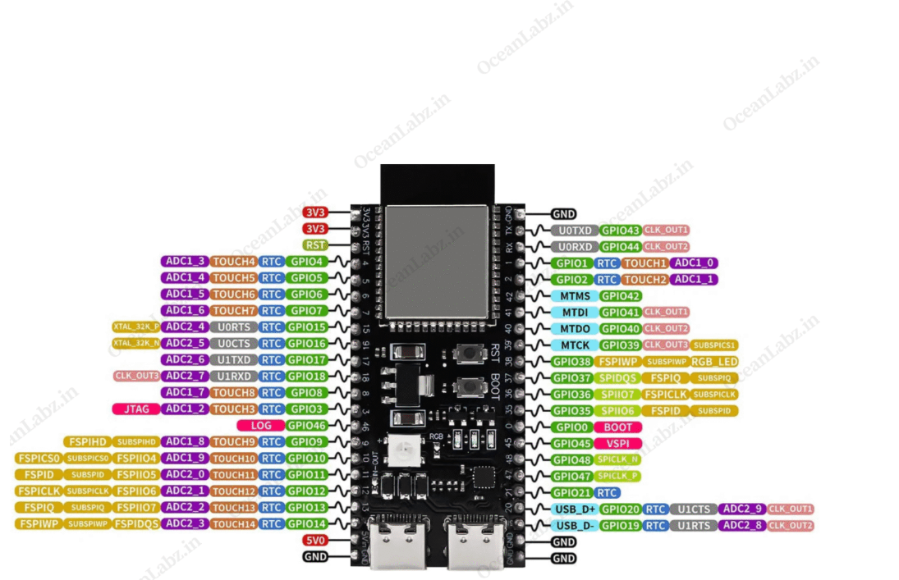

# ESP32-S3 LED Cube

Firmware and web-control software for an 8×8×8 addressable LED cube built
around the ESP32-S3.

The system provides real-time audio visualization, independently controlled
LED layers, Bluetooth communication, WiFi control, and a browser-based
management interface.

## System Overview

The cube contains 512 individually addressable WS2812 LEDs arranged as eight
8×8 layers.

Each layer has its own LED data connection to the controller:

    ESP32-S3
        |
        +-- DATA 0 --> Layer 0 (64 LEDs)
        +-- DATA 1 --> Layer 1 (64 LEDs)
        +-- DATA 2 --> Layer 2 (64 LEDs)
        +-- DATA 3 --> Layer 3 (64 LEDs)
        +-- DATA 4 --> Layer 4 (64 LEDs)
        +-- DATA 5 --> Layer 5 (64 LEDs)
        +-- DATA 6 --> Layer 6 (64 LEDs)
        +-- DATA 7 --> Layer 7 (64 LEDs)

LED data is transmitted using the ESP32-S3 RMT peripheral.

The project also contains an audio DSP pipeline using an I2S microphone and
FFT-based spectrum analysis for real-time LED visualization.

## Hardware

### Pinout

### Controller

- ESP32-S3-WROOM
- ESP-IDF 5.5.2
- 16 MB flash
- 8 independent LED layer outputs
- RMT-based WS2812 driver
- I2S digital microphone input
- WiFi SoftAP
- Bluetooth Low Energy

### LED Cube

- 8 × 8 × 8 LED arrangement
- 512 WS2812 LEDs
- 64 LEDs per layer
- Separate 5 V power feed for each layer
- Independent data signal for each layer

### Audio Input

The primary digital audio path uses an INMP441 I2S microphone.

    INMP441
       |
       | I2S
       v
    ESP32-S3
       |
       v
    Audio Buffer
       |
       v
    1024-point FFT
       |
       v
    Spectrum Mapping
       |
       v
    LED Visualization

The DSP pipeline removes DC offset, applies a Hann window, performs a
1024-point radix-2 FFT, and maps the resulting frequency spectrum into LED
visualization bands.

## Firmware Architecture

The ESP32 firmware is organized into several subsystems:

    main/
    |
    +-- app/
    |   +-- Application startup and task coordination
    |
    +-- ble/
    |   +-- Bluetooth communication and telemetry
    |
    +-- dsp/
    |   +-- Audio buffering
    |   +-- FFT processing
    |   +-- Spectrum mapping
    |   +-- DSP pipeline
    |
    +-- led/
    |   +-- Cube coordinate mapping
    |   +-- Cube state
    |   +-- RMT output
    |   +-- Rendering
    |   +-- LED effects
    |
    +-- web/
    |   +-- backend/
    |   |   +-- WiFi access point
    |   |   +-- HTTP API
    |   |   +-- WebSocket server
    |   |
    |   +-- frontend/
    |       +-- Svelte
    |       +-- Tailwind CSS
    |       +-- Three.js
    |
    +-- common/
    |   +-- Shared application utilities
    |
    +-- test/
        +-- Hardware and firmware test utilities

## LED Cube Coordinate System

The firmware represents each LED as a voxel:

    (x, y, z)

where each coordinate ranges from 0 through 7.

`led_cube_set_voxel()` modifies the logical cube state, while the cube mapper
converts logical coordinates into the physical LED index and layer.

The physical transmission details remain isolated inside the RMT driver.

## Audio DSP

The current FFT implementation uses:

- Frame size: 1024 samples
- Frequency bins: 512
- Hann window
- DC removal
- Iterative radix-2 Cooley-Tukey FFT
- Magnitude calculation
- Spectrum band mapping
- Noise gating
- Smoothing
- Normalization

The normalized DSP output is consumed by the LED visualization system.

## WiFi

The ESP32 can operate as a WiFi access point.

Default development configuration:

    SSID: LED-Cube
    Address: 192.168.4.1

When web mode is enabled, connecting to this network provides access to the
embedded web interface.

## Web Interface

The browser interface is implemented using:

- Svelte
- Vite
- Tailwind CSS
- Three.js

The production frontend is compiled by Vite and embedded directly into the
ESP32 firmware.

The ESP32 serves:

    GET /                  Svelte application
    GET /assets/app.js     Compiled JavaScript
    GET /assets/app.css    Compiled CSS

After connecting to the LED-Cube WiFi network, open:

    http://192.168.4.1

No separate web server is required at runtime.

## HTTP API

The ESP32 exposes an HTTP API used by the Svelte frontend and available to
other clients on the LED-Cube network.

### Administrator Login

    POST /api/admin/login

Request:

    {
      "username": <uname>,
      "password": <password>
    }

Successful response:

    {
      "authenticated": true
    }

Invalid credentials return:

    401 Unauthorized

### Connected Clients

    GET /api/admin/clients

Returns devices currently connected to the ESP32 access point.

Example:

    [
      {
        "mac": "D6:B9:31:B3:9D:1F",
        "ip": "192.168.4.2"
      }
    ]

An empty array is returned when no clients are connected.

## WebSocket API

The ESP32 also exposes:

    ws://192.168.4.1/ws

The administrator dashboard uses this connection to receive immediate
notifications when the WiFi client list changes.

Example event:

    {
      "event": "clients_changed"
    }

The WebSocket notification does not contain the complete client state.

After receiving `clients_changed`, the client requests:

    GET /api/admin/clients

This keeps the HTTP API as the authoritative source for the current client
list.

## Building the Frontend

From:

    main/web/frontend

install dependencies:

    npm install

Build the production frontend:

    npm run build

The generated files are:

    dist/
    +-- index.html
    +-- assets/
        +-- app.js
        +-- app.css

These files are currently embedded into the ESP-IDF application using
`EMBED_FILES`.

At the current development stage, `dist/` must exist before the ESP-IDF
firmware is built.

## Building the Firmware

The project requires ESP-IDF 5.5.2.

From the repository root:

    idf.py build

To build, flash, and open the serial monitor:

    idf.py flash monitor

## Flash Layout

The ESP32-S3 module contains 16 MB of flash.

The project uses a custom partition table defined by:

    partitions.csv

The factory application partition is currently 8 MB.

This larger application partition accommodates the firmware, networking
components, Bluetooth stack, DSP implementation, and embedded web frontend.

## Power

The completed cube uses an external regulated 5 V supply.

Each of the eight LED layers receives an independent 5 V power feed. LED data
is controlled independently for each layer.

The controller and LED power system must share a common ground so that the
LED data signals have the correct electrical reference.

## Current Development Status

Implemented:

- ESP32-S3 application framework
- 8-layer cube representation
- Logical voxel mapping
- RMT LED output
- LED effects framework
- INMP441 I2S audio acquisition
- 1024-point FFT
- Spectrum mapping and conditioning
- BLE communication
- WiFi SoftAP
- Embedded HTTP server
- Svelte frontend
- Administrator login endpoint
- Connected-client API
- WebSocket client-change notifications
- Embedded frontend serving

Still under development:

- Complete LED cube hardware
- Final audio visualization behavior
- Web control interface
- Administrator session authentication
- Additional LED effects and controls
- Production credential handling
- Final hardware integration

## Development Notes

The current administrator login verifies credentials but does not yet create
an authenticated session. `/api/admin/clients` and `/ws` should therefore be
considered development interfaces rather than protected administrative
resources.

The WebSocket implementation currently tracks a single administrator
connection.

The frontend build is currently performed separately from the ESP-IDF build.
A future build-system update can invoke the Vite build automatically before
embedding the generated frontend assets.